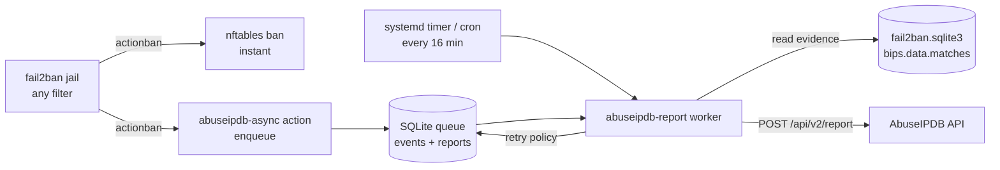

# Fail2Ban_AbuseIPDB

[](https://github.com/paulmann/Fail2Ban_AbuseIPDB/actions/workflows/ci.yml)
[](CHANGELOG.md)
[](pyproject.toml)
[](pyproject.toml)
[](#compatibility)
[](tests)
[](LICENSE)

> **Asynchronous fail2ban → AbuseIPDB reporting.**
> Every ban is queued locally in SQLite; a scheduled worker turns the queue into
> rich, evidence-backed abuse reports - and never lets an unavailable API, a
> rate limit or a reboot slow down or break the ban itself.

Fail2Ban protects a server by banning abusive IPs. AbuseIPDB makes those bans
useful for the whole internet, but the stock integration runs `curl` *inside* the
ban action: every ban becomes a synchronous HTTP request executed by a root
process, with no retry, no rate-limit handling and a shell command built from
attacker-controlled log text.

This project separates the two concerns:

* **ban path** - instant, local, can never fail because of a remote API;
* **report path** - a scheduled worker drains a local queue, respects AbuseIPDB
  limits, retries failures and attaches the evidence that fail2ban itself
  recorded for the ban.

---

## The problem with the stock action

The official AbuseIPDB + Fail2Ban recipe is:

```ini
actionban = curl ... --data-urlencode 'comment=<matches>' ... -H "Key: <apikey>"
```

It works until it doesn't:

| Reality | Stock action | This project |
|---|---|---|
| AbuseIPDB is slow or down | the ban action blocks, then fails | ban applied instantly, report queued |
| Same IP banned again | duplicate report, HTTP 429 in the ban path | per-IP throttle, one report per 20 min |
| fail2ban restarts | restored bans are re-reported | `norestored = 1`, queue preserved |
| Many bans in a burst | one HTTP request per ban, sequentially | aggregated queue, 25 reports per tick |
| Daily API quota reached | every action fails | run stops, queue waits for tomorrow |
| Comment quality | raw log dump, `\n` escapes | short structured report with categories |
| Command injection surface | `<matches>` is interpolated into a shell command | only `<ip>`, `<name>`, `<bantime>`, `<failures>` reach the shell |

The last row is not theoretical: the matched log line contains the attacker's
request URL. A URL can contain backticks or `$()`; the action runs as root.

---

## How it works



1. fail2ban applies the firewall ban as usual.
2. The extra action writes one event: `ip`, jail, ban time, ban duration,
   failure count. This is a local SQLite insert - a fraction of a second.
3. Every 16 minutes a oneshot service (or a cron job) groups pending events by
   IP, reads the matched log lines from fail2ban's own database, builds a
   comment with the attack type, time, counters and sample requests, and calls
   `POST /api/v2/report`.
4. Responses are interpreted: `200` marks the event reported, `429` defers,
   `422` marks it invalid, `5xx`/timeouts are retried with a bounded attempt
   counter. Nothing is lost, nothing is spammed.

---

## Features

| | |
|---|---|
| 🔌 **Drop-in fail2ban action** | Attach to any jail - `sshd`, `nginx-*`, `proftpd`, `exim-*`, custom filters. The installer generates the jail snippet. |
| 🧱 **Zero dependencies** | Python standard library only. No pip, no venv, no daemons. ~13 MB RSS per run. |
| 🔑 **Key file, not config** | The API key lives in `/etc/abuseipdb/.abuseipdb.key` (mode 600), separate from code and configuration - updates can never overwrite it. |
| 👋 **First-run wizard** | No key anywhere? The installer (or `abuseipdb-report --setup`) asks once, validates it and saves it to the key file. |
| 🔄 **Self-update** | `abuseipdb-upgrade --check` compares the installed version with `updater.json` on GitHub; `--upgrade` verifies the SHA-256 of the release tarball, runs the installer and keeps config + key intact. |
| 🗄️ **Durable queue** | SQLite (WAL) on disk; survives reboot; `Persistent=true` timer catches up missed ticks. |
| 🚦 **Rate-limit aware** | One report per IP per 20 minutes, 900/day, 25/run - inside the free AbuseIPDB plan. |
| 🧾 **Evidence-backed comments** | Attack type, time window, ban duration, failure count, generic patterns and the attacker's own URLs - read from fail2ban's database, no log scraping. |
| 🏷️ **Correct categories** | Per-jail category map; SQL-injection attempts automatically add category 16. |
| 🛡️ **No command injection** | Attacker-controlled log text is never passed to a shell. |
| 🔒 **PII-free** | No attempted usernames, no mail content, no client domains - only the attacker's IP and requests. |
| 📣 **Self-advertising footer** | Every report ends with a configurable attribution line - `Reported via Fail2Ban_AbuseIPDB Monitor: https://github.com/paulmann/Fail2Ban_AbuseIPDB` - so the project spreads with every ban it reports. Disable it with one option. |
| 👁️ **Observable** | `--stats`, `--dry-run`, `--check-key`, structured log, logrotate config. |
| 🧪 **Tested** | 53 unit tests + an end-to-end integration test against a mock API, plus a shellcheck/CI gate. |
| ♻️ **Safe installer** | Backups every replaced file, `fail2ban-client -t` before restart, state-driven uninstall, staging mode. |

---

## Quick start

```bash
git clone https://github.com/paulmann/Fail2Ban_AbuseIPDB.git
cd Fail2Ban_AbuseIPDB

# 1. Install (default: attach to the sshd jail)
sudo ./install.sh --api-key "YOUR_ABUSEIPDB_API_KEY"
#    or just `sudo ./install.sh` - on a terminal it asks for the key once and
#    stores it in /etc/abuseipdb/.abuseipdb.key (mode 600)

# 2. Report web and FTP attacks too (the jails you actually have)
sudo ./install.sh --api-key "YOUR_ABUSEIPDB_API_KEY" \
  --jails "sshd nginx-attack-scan nginx-wp-login nginx-php-probe proftpd exim-auth-fail"

# 3. Watch it work
/usr/local/sbin/abuseipdb-report --stats
tail -f /var/log/abuseipdb-reporter.log
```

The first real ban is queued immediately and reported on the next timer tick.

### Verify without waiting for an attack

```bash
# queue a ban for a real attacker address from your logs (not your own IP!)
/usr/local/sbin/abuseipdb-enqueue --ip 198.51.100.7 --jail sshd \
  --bantime 86400 --failures 4

# inspect the payload, then send it
/usr/local/sbin/abuseipdb-report --dry-run
/usr/local/sbin/abuseipdb-report
```

> ⚠️ `fail2ban-client set <jail> banip <address>` **bypasses `ignoreip`** (that is
> fail2ban behaviour). Never test with your own management address.

---

## Installation

### Requirements

Linux, Python 3.9+, Fail2Ban 0.10+, root access, and an
[AbuseIPDB API key](https://www.abuseipdb.com/account/api) (free plan is enough).
See [docs/INSTALL.md](docs/INSTALL.md) for the full reference.

### Installer

```bash
sudo ./install.sh [--api-key KEY] [--jails "LIST"] [--all-jails] [options]
```

| Option | Meaning |
|---|---|
| `--api-key KEY` / `--api-key-file FILE` | API key (or `ABUSEIPDB_API_KEY` env); saved to the key file |
| `--key-file PATH` | key file (default `/etc/abuseipdb/.abuseipdb.key`) |
| `--jails "LIST"` | jails to attach the action to (default on upgrade: the configured ones; fresh install: `sshd`) |
| `--with-update-check` | weekly `abuseipdb-upgrade --check` timer/cron (check only, never auto-installs) |
| `--all-jails` | every enabled jail except `recidive` |
| `--cron` | cron instead of the systemd timer |
| `--no-restart` | do not restart fail2ban |
| `--skip-api-check` | skip online key validation |
| `--root DIR` | stage the whole installation under `DIR` (CI, containers) |
| `--dry-run` | print actions, change nothing |
| `--uninstall` / `--purge` | remove files / remove everything |

Everything the installer writes:

```
/usr/local/lib/abuseipdb_reporter/       Python package (stdlib only)
/usr/local/sbin/abuseipdb-report         worker
/usr/local/sbin/abuseipdb-enqueue        queue helper
/etc/abuseipdb/reporter.conf             configuration, mode 600
/etc/abuseipdb/.abuseipdb.key            API key, mode 600 (preserved by updates)
/var/lib/abuseipdb/abuseipdb.sqlite3     queue + report journal
/etc/fail2ban/action.d/abuseipdb-async.conf
/etc/fail2ban/jail.d/50-abuseipdb-reporter.local
/etc/systemd/system/abuseipdb-report.{service,timer}   (or /etc/cron.d/...)
/etc/logrotate.d/abuseipdb-reporter
/var/log/abuseipdb-reporter.log
```

A backup of every replaced file is stored under
`/var/backups/fail2ban-abuseipdb/<timestamp>/`, and `./install.sh --uninstall`
restores the previous state using an install state file.

---

## Configuration

`/etc/abuseipdb/reporter.conf` (mode 600) - full reference in
[docs/CONFIGURATION.md](docs/CONFIGURATION.md):

```ini
[abuseipdb]
api_key_file = /etc/abuseipdb/.abuseipdb.key   # separate file, survives updates
enabled = yes
min_interval_ip = 1200        # >= 900 required by AbuseIPDB
max_reports_per_run = 25
max_reports_per_day = 900     # free plan: 1000 checks + reports
comment_max_bytes = 1000      # API hard limit: 1024
skip_jails = recidive

[database]
path = /var/lib/abuseipdb/abuseipdb.sqlite3
fail2ban_db = /var/lib/fail2ban/fail2ban.sqlite3
retention_days = 30

[report]
server_ip = 203.0.113.10
attribution = yes             # footer that advertises this project
attribution_text = Reported via Fail2Ban_AbuseIPDB Monitor: https://github.com/paulmann/Fail2Ban_AbuseIPDB

[ignore]
# private/loopback/reserved + your own management networks + CDN ranges
ranges = 10.0.0.0/8, 192.168.0.0/16, 127.0.0.0/8, 203.0.113.10/32, ...

[category_map]
sshd = 18,22
nginx-attack-scan = 21,19
nginx-wp-login = 21,18
proftpd = 18,5
```

The installer fills in `server_ip`, `hostname` and the policy for the jails you
selected; the rest are safe defaults.

### Categories

| Jail | Categories | AbuseIPDB meaning |
|---|---|---|
| `sshd` | `18,22` | Brute-Force, SSH |
| `proftpd` | `18,5` | Brute-Force, FTP Brute-Force |
| `exim-auth-fail` | `18` | Brute-Force (SMTP AUTH) |
| `nginx-attack-scan` | `21,19` | Web App Attack, Bad Web Bot |
| `nginx-wp-login` | `21,18` | Web App Attack, Brute-Force |
| `nginx-php-probe` | `21,15` | Web App Attack, Hacking |
| `nginx-forbidden` | `21` | Web App Attack |

SQL injection in a requested URL adds category **16** automatically.

---

## What a report looks like

SSH brute-force (evidence comes from the log lines that fail2ban matched):

```
Automated fail2ban report from server 203.0.113.10.
Attack type: SSH brute-force (jails: sshd).
Observed: 2026-01-02T03:04:05+00:00.
Detections: 1 ban event(s), 4 failed attempts.
Ban duration: 4d.
Patterns: PAM authentication failures; root password attempts; invalid usernames tried.
Log evidence:
  sshd-session[123]: pam_unix(sshd:auth): authentication failure; ... rhost=198.51.100.7 user=root
  sshd-session[123]: Failed password for root from 198.51.100.7 port 22 ssh2
No personal data included.
--
Reported via Fail2Ban_AbuseIPDB Monitor: https://github.com/paulmann/Fail2Ban_AbuseIPDB
```

Web application scanning:

```
Automated fail2ban report from server 203.0.113.10.
Attack type: web application vulnerability scanning/exploitation attempts (jails: nginx-attack-scan).
Observed: 2026-01-02T03:04:05+00:00.
Detections: 1 ban event(s), 5 failed attempts.
Ban duration: 1d.
Sample requests/indicators:
  GET /.env -> 404
  GET /.git/config -> 404
  GET /wp-admin/install.php?step=1 -> 404
  GET /api/v1/items?id=1%20UNION%20SELECT%20@@version -> 404
No personal data included.
--
Reported via Fail2Ban_AbuseIPDB Monitor: https://github.com/paulmann/Fail2Ban_AbuseIPDB
```

---

## CLI

```bash
abuseipdb-report                 # drain the queue (timer runs this)
abuseipdb-report --stats         # queue and journal statistics
abuseipdb-report --dry-run       # print payloads, send nothing
abuseipdb-report --check-key     # validate the API key (one /check request)
abuseipdb-report --config FILE   # alternative configuration file

abuseipdb-enqueue --ip IP --jail JAIL --bantime SECONDS --failures N

abuseipdb-report --setup          # first run: ask for the key and save it
abuseipdb-report --migrate-key    # move a legacy api_key out of reporter.conf
abuseipdb-report --key-status     # where the key comes from (masked)

abuseipdb-upgrade --check         # 0 = up to date, 10 = update available
abuseipdb-upgrade --upgrade       # verify SHA-256 and install the update
```

### API key management

The key is **never** stored in the code, the repository or the configuration
file. Resolution order:

1. `--api-key` (one-off, not persisted);
2. `ABUSEIPDB_API_KEY` / `ABUSEIPDB_KEY` environment variables;
3. the key file (`api_key_file`, default `/etc/abuseipdb/.abuseipdb.key`,
   mode 600; `ABUSEIPDB_KEY_FILE` overrides the path);
4. legacy `api_key` in `reporter.conf` (deprecated, migrated automatically by
   the installer or `--migrate-key`);
5. interactive prompt on the first interactive run - the key is validated and
   saved to the key file.

Updating the code, re-running the installer or using `abuseipdb-upgrade` never
rewrites an existing key file: it is not part of the release tarball and the
installer explicitly keeps it.

### Self-update

The repository publishes `updater.json` with the latest version, the release
tarball URL and its SHA-256. `abuseipdb-upgrade` is installed next to the
reporter:

```bash
abuseipdb-upgrade --check --json     # machine-readable check
abuseipdb-upgrade --upgrade --yes    # download, verify SHA-256, run installer
```

The updater refuses archives without a checksum, rejects path traversal and
device/link entries, snapshots the key file before the installer runs and
restores it if anything goes wrong. Enable the optional weekly check with
`--with-update-check`; it only reports availability, it never installs in the
background.

---

## Reliability and limits

| Situation | Behaviour |
|---|---|
| API unavailable / timeout | event stays pending, retried on later ticks (max 10 attempts) |
| `429` per IP | event deferred; the reporter never sends two reports for one IP within 20 minutes |
| `429` daily quota | run stops; queue waits for the next day |
| `401` | run stops, error logged; fix `api_key` (picked up on the next tick) |
| `422` | event marked invalid, never retried |
| fail2ban restart | restored bans are not re-queued (`norestored = 1`) |
| host reboot | SQLite queue is durable; `Persistent=true` runs the missed tick |
| concurrent workers | `/run` lock: only one worker at a time |

AbuseIPDB free plan: **1000 reports + checks per day** and **one report per IP per
15 minutes**. The defaults (900/day, 20 min/IP) stay inside both limits.

---

## Security

* **API key** lives only in `/etc/abuseipdb/reporter.conf` (mode 600, root). It is
  never passed to fail2ban, never appears in logs and never reaches the shell.
* **No command injection**: the fail2ban action interpolates only values that
  fail2ban generates (`<ip>`, `<name>`, `<bantime>`, `<failures>`). Log lines are
  read from fail2ban's SQLite database by the Python worker - they never touch a
  shell. The stock `abuseipdb.conf` action does interpolate `<matches>`; this
  project deliberately does not.
* **Privacy**: reports contain the attacker's IP, the jail, counters and (for web
  jails) the attacker's own request URLs. Attempted usernames, mail content and
  client domains are not included.
* **Least privilege**: the worker runs as a oneshot systemd service with
  `ProtectSystem=full`, `ProtectHome=true`, `NoNewPrivileges=true` and write
  access limited to the queue directory and `/var/log`.
* **Ignore list**: private, loopback, link-local, documentation and reserved
  ranges are never reported; add your own management networks and CDN ranges.

See [SECURITY.md](SECURITY.md) for the vulnerability reporting policy.

---

## Testing

```bash
# 53 unit tests (Python 3.9+, no network, no root)
python -m unittest discover -v -s tests -t .

# end-to-end test: real worker + queue + mock AbuseIPDB API (no external calls)
bash tests/integration/run_integration.sh

# syntax/lint gates used by CI
python -m compileall -q src
shellcheck -x install.sh uninstall.sh tests/integration/run_integration.sh
```

CI runs the unit tests on Python 3.9-3.13, shellcheck for the installer and a
staged installation/uninstallation under `/tmp`.

---

## Project layout

```
Fail2Ban_AbuseIPDB/
├── install.sh / uninstall.sh          installer: backups, staging, state-driven uninstall
├── bin/                               CLI entry points
├── src/abuseipdb_reporter/            Python package (stdlib only)
├── config/reporter.conf.example       annotated configuration
├── fail2ban/action.d + jail.d/        action and jail snippet template
├── systemd/ + cron/ + logrotate/      scheduling and log rotation
├── tests/                             unit + integration tests
├── tools/mock_abuseipdb.py            mock API for tests and demos
├── docs/                              install, configuration, architecture, troubleshooting
└── .github/workflows/ci.yml           CI
```

---

## Compatibility

| | |
|---|---|
| OS | Linux (systemd or cron); any distribution with Python 3.9+ |
| fail2ban | 0.10+ (tested with 1.1.0) |
| Python | 3.9, 3.10, 3.11, 3.12, 3.13 |
| AbuseIPDB API | v2 (`/report`, `/check`) |
| Firewall | independent - the project only adds a queue action, bans stay fail2ban's job |

Windows and macOS are not supported for deployment (the fail2ban action and the
scheduler are Linux-specific), but the Python package and the test suite run on
any platform.

---

## FAQ

**Does this replace my fail2ban ban action?**
No. It is an *additional* action. Your nftables/iptables action stays exactly as
it is; the ban is applied instantly as before.

**Why 16 minutes if the API allows 15?**
AbuseIPDB rejects a second report for the same IP within 15 minutes. A 16-minute
timer plus a 20-minute per-IP throttle keeps the account comfortably inside the
limit. The timer rate is not the hard limit - the throttle is.

**Can I report only sshd?**
Yes - that is the default (`--jails "sshd"`). Add web jails when you have them.

**Will my server's own address be reported?**
No. `[ignore] ranges` contains private/reserved space, and the installer adds a
placeholder for your management address; add your public addresses there as
well. The reporter also refuses non-public IPs before queueing.

**What if AbuseIPDB changes the API?**
The two endpoints are isolated in `src/abuseipdb_reporter/api.py`; adjusting the
request there is enough. Rate/error handling is status-code based.

**Will an update overwrite my API key?**
No. The key lives in `/etc/abuseipdb/.abuseipdb.key`, is not part of the release
tarball and the installer keeps an existing key file untouched (verified by the
CI upgrade test). If a legacy `api_key` is still in `reporter.conf`, it is
migrated into the key file and the config line is blanked.

**How do I update the installation?**
`sudo abuseipdb-upgrade --check` to see whether a newer version exists, then
`sudo abuseipdb-upgrade --upgrade`. Re-running `install.sh` from a fresh
checkout does the same and also preserves the key, configuration, queue and
the jail list.

**Where are the reports if the queue is full?**
On disk, in `/var/lib/abuseipdb/abuseipdb.sqlite3` (`events.reported = 0`). They
are drained in order, oldest first, up to the configured budgets.

**Why does every report contain a link to this project?**
That is the `[report] attribution` footer - a small, factual credit that makes
the project discoverable through public AbuseIPDB comments. It never replaces
evidence and is always the last line, even when the comment is truncated. Set
`attribution = no` to disable it or `attribution_text` to put your own link.

---

## Documentation

* [Installation](docs/INSTALL.md)
* [Configuration](docs/CONFIGURATION.md)
* [Architecture](docs/ARCHITECTURE.md)
* [Self-update](docs/UPDATE.md)
* [Troubleshooting](docs/TROUBLESHOOTING.md)
* [Changelog](CHANGELOG.md)

### 📚 Wiki (the long-form documentation)

The [GitHub Wiki](https://github.com/paulmann/Fail2Ban_AbuseIPDB/wiki) is the operator's manual:

| Start | Fail2Ban deep dive | For AI agents |
|---|---|---|
| [Why This Exists](https://github.com/paulmann/Fail2Ban_AbuseIPDB/wiki/01-Why-This-Exists) | [Fundamentals](https://github.com/paulmann/Fail2Ban_AbuseIPDB/wiki/08-Fail2Ban-Fundamentals) | [Installation prompts](https://github.com/paulmann/Fail2Ban_AbuseIPDB/wiki/12-Agent-Prompts-Installation) |
| [Getting Started](https://github.com/paulmann/Fail2Ban_AbuseIPDB/wiki/02-Getting-Started) | [Web protection](https://github.com/paulmann/Fail2Ban_AbuseIPDB/wiki/09-Fail2Ban-Web-Protection) | [Fail2Ban setup prompts](https://github.com/paulmann/Fail2Ban_AbuseIPDB/wiki/13-Agent-Prompts-Fail2Ban-Setup) |
| [Architecture](https://github.com/paulmann/Fail2Ban_AbuseIPDB/wiki/03-Architecture) | [SSH, mail, FTP](https://github.com/paulmann/Fail2Ban_AbuseIPDB/wiki/10-Fail2Ban-SSH-Mail-FTP) | [Operations & audit prompts](https://github.com/paulmann/Fail2Ban_AbuseIPDB/wiki/14-Agent-Prompts-Operations-and-Audit) |
| [Configuration](https://github.com/paulmann/Fail2Ban_AbuseIPDB/wiki/04-Configuration-Reference) | [Verification & rollback](https://github.com/paulmann/Fail2Ban_AbuseIPDB/wiki/11-Fail2Ban-Verification-and-Rollback) | [Self-update](https://github.com/paulmann/Fail2Ban_AbuseIPDB/wiki/06-Self-Update) |
| [API keys](https://github.com/paulmann/Fail2Ban_AbuseIPDB/wiki/05-API-Key-Management) | [Troubleshooting](https://github.com/paulmann/Fail2Ban_AbuseIPDB/wiki/15-Troubleshooting) | [FAQ](https://github.com/paulmann/Fail2Ban_AbuseIPDB/wiki/16-FAQ) |
* [Contributing](CONTRIBUTING.md)
* [Security policy](SECURITY.md)

---

## Contributing

Issues and pull requests are welcome. Please read
[CONTRIBUTING.md](CONTRIBUTING.md) first - it describes the development setup,
the test suite and the conventions used in this project.

## License

[MIT](LICENSE) © 2026 Mikhail Deynekin

## Acknowledgements

* [Fail2Ban](https://github.com/fail2ban/fail2ban) - the engine that makes the
  evidence available and safe to reuse.
* [AbuseIPDB](https://www.abuseipdb.com/) - the community database these reports
  feed.

> **Disclaimer:** this project only reports bans that fail2ban has already
> applied. Reports are public; make sure your `[ignore]` list contains your own
> and trusted addresses before enabling a broad jail set.