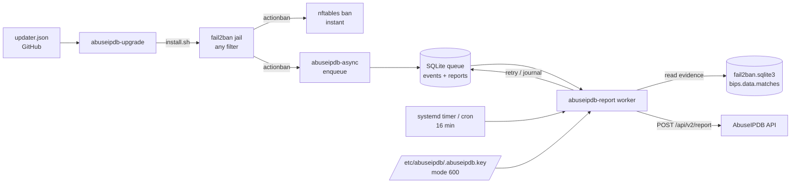

# Fail2Ban_AbuseIPDB

**Asynchronous fail2ban → AbuseIPDB reporting with a durable local queue.**

[**Wiki**](https://github.com/paulmann/Fail2Ban_AbuseIPDB/wiki) · [**Documentation**](docs/) · [**Releases**](https://github.com/paulmann/Fail2Ban_AbuseIPDB/releases) · [**Changelog**](CHANGELOG.md) · [**Issues**](https://github.com/paulmann/Fail2Ban_AbuseIPDB/issues) · [**Security**](SECURITY.md)


[](https://github.com/paulmann/Fail2Ban_AbuseIPDB/actions/workflows/ci.yml)
[](https://github.com/paulmann/Fail2Ban_AbuseIPDB/releases)
[](LICENSE)
[](https://www.python.org/downloads/)
[](#requirements-and-compatibility)
[](tests)
[](https://github.com/paulmann/Fail2Ban_AbuseIPDB/wiki)
[](https://github.com/paulmann/Fail2Ban_AbuseIPDB/stargazers)

Fail2Ban knows **who** attacked and **why**. AbuseIPDB wants a short factual report per abusive IP. The stock integration runs `curl` inside the ban action, so the ban, the firewall and a remote API become one synchronous root-shell path: a slow API delays bans, a rate limit makes actions fail, a restart re-reports restored bans, and attacker-controlled log text is interpolated into a shell command.

This project separates the two paths. The ban stays local and instant. A small SQLite queue stores what happened. A scheduled worker (systemd timer or cron, every 16 minutes) turns the queue into evidence-backed reports, respects AbuseIPDB rate limits, retries failures and never blocks the firewall. The API key lives in its own file, and `abuseipdb-upgrade` updates the installation from GitHub without losing the key, the configuration, the queue or the jail list.

> **Documentation status.** Counts in this README were re-measured from the published tree on 2026-10-20 (v1.1.1): 88 tests, 13 source modules, 66 tracked files, 18 wiki pages. The operator-facing long-form documentation lives in the [Wiki](https://github.com/paulmann/Fail2Ban_AbuseIPDB/wiki); the design-level documents live under [`docs/`](docs/).

---

## Contents

- [What this is and why](#what-this-is-and-why)
- [Use cases](#use-cases)
- [Capabilities](#capabilities)
- [By the numbers](#by-the-numbers)
- [How it works](#how-it-works)
- [Installation](#installation)
- [First steps](#first-steps)
- [Fail2Ban configuration](#fail2ban-configuration)
- [Configuration reference](#configuration-reference)
- [What a report looks like](#what-a-report-looks-like)
- [Command line](#command-line)
- [Agent prompts](#agent-prompts)
- [Reliability and limits](#reliability-and-limits)
- [Security](#security)
- [Requirements and compatibility](#requirements-and-compatibility)
- [Documentation](#documentation)
- [Development](#development)
- [FAQ](#faq)
- [Contributing](#contributing)
- [License](#license)

---

## What this is and why

The official AbuseIPDB integration is a shell command inside `actionban`:

```ini
actionban = lgm=$(printf '%.1000s\n...' "<matches>"); \
            curl -sSf "https://api.abuseipdb.com/api/v2/report" \
              -H "Key: <abuseipdb_apikey>" --data-urlencode "comment=$lgm" \
              --data-urlencode "ip=<ip>" --data "categories=<abuseipdb_category>"
```

Three systems are now coupled to one event. If the API is slow, the ban action is slow. If the API returns 429, the action fails. If fail2ban restarts with a persistent database, restored bans are pushed through the action again. With web jails, `<matches>` contains text chosen by the attacker, and that text is evaluated by a root shell before `curl` ever runs.

This project makes four different choices:

1. **The ban path never talks to the network.** An extra action writes one row into a local SQLite queue (measured: about 0.1 s, including Python start-up) and returns. The firewall ban is applied by the ordinary action, unchanged.
2. **Reports are built from fail2ban's own evidence.** Fail2Ban stores the matched log lines in its database (`bips.data.matches`). The worker reads them read-only. Only `<ip>`, `<name>`, `<bantime>` and `<failures>` are passed to the queue helper — all generated by fail2ban itself, never attacker text into a shell.
3. **Rate limits are part of the design.** One report per IP per 20 minutes, 900 reports per day, 25 per run. A 429 is a normal state: the event stays queued and is retried later.
4. **The key is not part of the configuration.** It lives in `/etc/abuseipdb/.abuseipdb.key` (mode 600), is excluded from git and from release archives, and survives re-installs and self-updates.

### Measured on a production host

One public web host (25 sites, fail2ban 1.1.0) over roughly 3.5 days:

| Signal | Volume | Detail |
|---|---|---|
| SSH authentication failures | **8,070** events / **507** unique IPs | `Invalid user`: 3,581 more; top source: 261 attempts from one IP |
| Web requests matching attack signatures | **42,756** of 96,245 requests (44%) | `/.env`, `/.git`, `/.ssh`, traversal, WordPress, Grafana/Langflow probes |
| `Primary script unknown` PHP probes | **6,176** | non-existent `.php` names |
| SMTP AUTH failures | **6,750** in one day | dominated by one IP (855) |
| FTP failed logins | **3,995** in one day | two IPs (3,720 + 273) |
| Result after queueing | 12 reports/day, queue empty, no errors | ban path unaffected |

The numbers describe **one** busy host and are not a statistical claim. Full context: [Wiki — Why This Exists](https://github.com/paulmann/Fail2Ban_AbuseIPDB/wiki/01-Why-This-Exists).

The caveat that matters: the project does not ban better than fail2ban and does not replace fail2ban filters. It makes the **reporting** of existing bans reliable, rate-limit-safe and auditable.

---

## Use cases

| You are doing | Use | What comes back |
|---|---|---|
| Running fail2ban on a public host and wanting the abuse to feed AbuseIPDB | attach `abuseipdb-async` to the jails you already have | one report per banned IP per throttle window, with evidence |
| Handling scanner floods on nginx | create web jails, then attach the action | reports with the attacker's own URLs and categories 21/19/15/16 |
| Protecting SSH, mail and FTP | enable `sshd`, `exim-*`, `dovecot`, `proftpd`, `recidive` | brute-force reports with generic, PII-free patterns |
| Keeping a production firewall stable | the queue and the 16-minute worker | the API can be down, rate-limited or slow; bans still happen |
| Automating installs and audits with an AI agent | the [Wiki agent prompts](https://github.com/paulmann/Fail2Ban_AbuseIPDB/wiki/12-Agent-Prompts-Installation) | copy-paste prompts with guardrails, steps and acceptance checks |
| Updating many hosts | `abuseipdb-upgrade --check` / `--upgrade` | SHA-256-verified update that preserves key, config, queue and jails |
| Debugging "bans happen, reports don't" | `--stats`, `--dry-run`, `--check-key`, the journal | a specific broken link instead of guesses |

---

## Capabilities

| Capability | Detail |
|---|---|
| **Drop-in action for any jail** | `sshd`, `nginx-*`, `proftpd`, `exim-*`, `dovecot`, custom filters. The installer generates `/etc/fail2ban/jail.d/50-abuseipdb-reporter.local` and attaches the action only to the jails you list. |
| **Durable local queue** | SQLite with WAL on disk; survives reboots and fail2ban restarts. `norestored = 1` prevents re-reporting restored bans. |
| **Zero runtime dependencies** | Python standard library only: `urllib`, `sqlite3`, `ipaddress`, `tarfile`, `configparser`. No pip, no venv, no daemons. |
| **Evidence-backed comments** | Attack type, time window, ban duration, failure counters, generic patterns and (for web jails) the attacker's own request URLs, read from fail2ban's database. |
| **Correct AbuseIPDB categories** | Per-jail map; SQL-injection patterns in a request add category 16 automatically. |
| **No command injection** | Attacker-controlled log text never enters a shell: evidence is read from SQLite by Python and sent as a form-encoded body. |
| **PII-free by default** | No attempted usernames, no mail content, no client domains. Only the attacker IP, jail, counters and attacker URLs. |
| **Key file, not config** | `/etc/abuseipdb/.abuseipdb.key`, mode 600; resolution order: CLI flag, environment, key file, legacy config, interactive prompt on first run. |
| **First-run wizard** | If no key exists anywhere, an interactive run asks once, validates and saves it. Under systemd/cron it fails with a clear message instead of hanging. |
| **Self-update** | `updater.json` on GitHub; `abuseipdb-upgrade --check` (exit 10 = update) and `--upgrade` verify SHA-256, extract safely, preserve the key file and run the installer. |
| **Rate-limit aware** | 20 minutes per IP, 25 reports per run and 900/day by default — inside the free AbuseIPDB plan. |
| **Observable** | `--stats`, `--dry-run`, `--check-key`, `--key-status`, structured journal, logrotate configuration. |
| **Safe installer** | Backs up every replaced file, runs `fail2ban-client -t` before restarting, keeps state for a clean uninstall, supports staging with `--root`. |
| **Self-advertising footer** | Every report ends with a configurable attribution line; disable it with `attribution = no` or replace it with your own. |
| **Tested and gated** | 88 unit/integration tests, shellcheck, staged install/uninstall, CI on Python 3.9-3.13. |

---

## By the numbers

Measured from the published tree on 2026-10-20 (v1.1.1):

| Surface | Count | Measured from |
|---|---|---|
| Python package modules | **13** files · 1,562 lines | `src/abuseipdb_reporter/*.py` |
| Tests | **88** passing (1 skipped on Windows only) | `python -m unittest discover -s tests -t .` |
| Test code | 11 files · 1,182 lines | `tests/` |
| Installer and shell tooling | 750 lines | `*.sh` |
| Documentation pages | 8 | `docs/*.md` |
| Wiki pages | 18 | `Fail2Ban_AbuseIPDB.wiki` |
| Tracked files | 66 | `git ls-files` |
| Runtime dependencies | **0** | `pyproject.toml` (none) |
| Worker memory | about 13 MB RSS | measured on a production host |
| Enqueue latency | about 0.1 s | 10 enqueues in 1.06 s, including interpreter start-up |
| Supported Python | 3.9, 3.10, 3.11, 3.12, 3.13 | CI matrix |
| AbuseIPDB budget | 900 reports/day · 25/run · 20 min/IP | configuration defaults |

Production evidence for the same period: 12 reports/day from 332 active fail2ban bans, queue empty, no failed systemd units, `fail2ban-client -t` OK.

---

## How it works



| Component | Responsibility |
|---|---|
| `fail2ban/action.d/abuseipdb-async.conf` | `norestored = 1`; calls the queue helper with `<ip>`, `<name>`, `<bantime>`, `<failures>` only |
| `bin/abuseipdb-enqueue` | validates the address, applies ignore rules, writes one event (~0.1 s) |
| `src/abuseipdb_reporter/db.py` | SQLite schema, dedupe, state transitions, retention |
| `src/abuseipdb_reporter/evidence.py` | reads `bips.data.matches` from fail2ban's database, classifies lines |
| `src/abuseipdb_reporter/comments.py` | builds the PII-free comment, categories, timestamp, attribution |
| `src/abuseipdb_reporter/api.py` | `urllib` client, no dependencies |
| `src/abuseipdb_reporter/reporter.py` | run loop, budgets, throttles, error handling |
| `src/abuseipdb_reporter/keys.py` | key resolution, key file, first-run prompt, legacy migration |
| `src/abuseipdb_reporter/updater.py` | manifest check, SHA-256 verification, safe extraction, installer call |
| `bin/abuseipdb-report`, `bin/abuseipdb-upgrade` | worker CLI and self-update CLI |

**Ban path.** The filter matches; the firewall action bans; the extra action writes a queue row. No network, no secrets, no attacker-controlled text passed to a shell.

**Report path.** Every 16 minutes: take a lock, select pending IPs oldest first, skip IPs reported recently, stop at the run/day budgets, read evidence, build the payload, call the API, interpret the response, journal the attempt, commit, and delete old rows.

**Response policy.**

| Status | Meaning | Action |
|---|---|---|
| 200 | accepted | mark reported, journal |
| 401 | bad key | stop the run, clear error, retry next tick after the key is fixed |
| 429 "once in 15 minutes" | per-IP limit | keep pending, retry later |
| 429 daily/global | quota | stop the run, keep everything pending |
| 400 / 422 | invalid report | mark invalid, never retry |
| 5xx / timeout | transient | retry, give up after 10 attempts |

**Four design decisions.**

1. **Decouple the ban from the API.** A queue is the only thing the ban path can afford to touch.
2. **Use fail2ban's evidence, not log scraping.** The matched lines are already in fail2ban's database and cannot be forged by re-reading rotated logs.
3. **Keep the secret out of configuration and code.** A dedicated key file survives config regeneration, reinstalls and updates.
4. **Make updates verifiable.** The updater refuses an archive without a SHA-256, rejects traversal and links, and snapshots the key file before running the installer.

Full architecture: [Wiki — Architecture](https://github.com/paulmann/Fail2Ban_AbuseIPDB/wiki/03-Architecture) and [`docs/ARCHITECTURE.md`](docs/ARCHITECTURE.md).

---

## Installation

Requires Linux, Python 3.9+, Fail2Ban 0.10+, root access and a free [AbuseIPDB API key](https://www.abuseipdb.com/account/api).

### Quick start

```bash
git clone https://github.com/paulmann/Fail2Ban_AbuseIPDB.git
cd Fail2Ban_AbuseIPDB
sudo ./install.sh
```

On a terminal the installer asks for the API key once, hides the input and saves it to `/etc/abuseipdb/.abuseipdb.key` (mode 600). Non-interactive equivalent:

```bash
sudo ./install.sh --api-key "YOUR_ABUSEIPDB_API_KEY" --jails "sshd nginx-attack-scan nginx-wp-login nginx-php-probe"
```

Everything enabled:

```bash
sudo ./install.sh --api-key "YOUR_ABUSEIPDB_API_KEY" --all-jails --with-update-check
```

### Installer options

| Option | Meaning |
|---|---|
| `--api-key KEY` / `--api-key-file FILE` | API key (or `ABUSEIPDB_API_KEY` environment variable); saved to the key file |
| `--key-file PATH` | key file location (default `/etc/abuseipdb/.abuseipdb.key`) |
| `--jails "LIST"` | jails to attach the action to (default on upgrade: the configured ones; fresh install: `sshd`) |
| `--all-jails` | every enabled jail except the aggregate `recidive` |
| `--with-update-check` | weekly `abuseipdb-upgrade --check` timer or cron entry (check only, never installs) |
| `--cron` | use cron instead of the systemd timer |
| `--no-restart` | do not restart fail2ban after installation |
| `--skip-api-check` | skip online key validation (offline installs, CI) |
| `--root DIR` | stage the whole installation under `DIR` (CI, containers, rehearsal) |
| `--dry-run` | print what would be done, change nothing |
| `--uninstall` / `--purge` | remove the installation / remove everything including config, queue and key |
| `-y, --yes` | do not ask for confirmation |

### What the installer writes

```
/usr/local/lib/abuseipdb_reporter/       Python package (standard library only)
/usr/local/sbin/abuseipdb-report         worker
/usr/local/sbin/abuseipdb-enqueue        queue helper
/usr/local/sbin/abuseipdb-upgrade        self-updater
/etc/abuseipdb/reporter.conf             configuration, mode 600, no secrets
/etc/abuseipdb/.abuseipdb.key            API key, mode 600, preserved by updates
/var/lib/abuseipdb/abuseipdb.sqlite3     queue and report journal
/etc/fail2ban/action.d/abuseipdb-async.conf
/etc/fail2ban/jail.d/50-abuseipdb-reporter.local
/etc/systemd/system/abuseipdb-report.service, abuseipdb-report.timer
/etc/logrotate.d/abuseipdb-reporter
/var/log/abuseipdb-reporter.log
```

Every replaced file is backed up to `/var/backups/fail2ban-abuseipdb/pristine-<timestamp>/`, and an install-state file makes `--uninstall` able to restore the previous state.

The installer is idempotent. Re-running it keeps an existing key file untouched, keeps `reporter.conf`, keeps the queue and detects the already configured jail list when `--jails` is omitted. `fail2ban-client -t` is a hard gate before any restart.

### Verify

```bash
fail2ban-client get sshd actions
# The jail sshd has the following actions: nftables, abuseipdb-async

/usr/local/sbin/abuseipdb-report --key-status
# API key source: key file /etc/abuseipdb/.abuseipdb.key

/usr/local/sbin/abuseipdb-report --stats
systemctl list-timers abuseipdb-report.timer
```

### Upgrade

```bash
sudo /usr/local/sbin/abuseipdb-upgrade --check     # 0 = current, 10 = update available, 1 = error
sudo /usr/local/sbin/abuseipdb-upgrade --upgrade   # SHA-256 verified, key/config/queue/jails kept
```

Or re-run `install.sh` from a fresh checkout. Details: [Wiki — Self-Update](https://github.com/paulmann/Fail2Ban_AbuseIPDB/wiki/06-Self-Update) and [`docs/UPDATE.md`](docs/UPDATE.md).

### Uninstall

```bash
sudo ./install.sh --uninstall          # removes code/action/timer; keeps config, queue and key
sudo ./install.sh --uninstall --purge  # removes everything, including the key
```

### Non-root rehearsal

```bash
sudo ./install.sh --root /tmp/stage --api-key "..." --cron --skip-api-check --no-restart
```

This is the mode the CI uses to test install, reinstall (key and jail preservation) and uninstall.

---

## First steps

```bash
# 1. Queue a real attacker address from your logs - never your own management IP
/usr/local/sbin/abuseipdb-enqueue --ip 198.51.100.7 --jail sshd --bantime 86400 --failures 4

# 2. Inspect the exact payload without calling the API
/usr/local/sbin/abuseipdb-report --dry-run

# 3. Send it now instead of waiting for the timer
/usr/local/sbin/abuseipdb-report

# 4. Confirm the result
/usr/local/sbin/abuseipdb-report --stats
tail -n 20 /var/log/abuseipdb-reporter.log
```

Expected journal line:

```
reported ip=198.51.100.7 jail=sshd cats=18,22 size=402 -> 200 {"data":{"abuseConfidenceScore":100}}
```

> `fail2ban-client set <jail> banip <address>` bypasses `ignoreip` — this is fail2ban behaviour. Never test with the address you use to administer the server. Use a documentation range (`192.0.2.0/24`, `198.51.100.0/24`, `203.0.113.0/24`) or a real attacker address, and unban immediately.

---

## Fail2Ban configuration

This project reports bans; it does not replace fail2ban filters. The essentials below are enough to get correct jails and avoid the two traps that cause most incidents. The complete operator guide is in the wiki: [Fundamentals](https://github.com/paulmann/Fail2Ban_AbuseIPDB/wiki/08-Fail2Ban-Fundamentals), [Web protection](https://github.com/paulmann/Fail2Ban_AbuseIPDB/wiki/09-Fail2Ban-Web-Protection), [SSH, mail, FTP](https://github.com/paulmann/Fail2Ban_AbuseIPDB/wiki/10-Fail2Ban-SSH-Mail-FTP), [Verification and rollback](https://github.com/paulmann/Fail2Ban_AbuseIPDB/wiki/11-Fail2Ban-Verification-and-Rollback).

### Configuration precedence

Fail2Ban reads, in order: `jail.conf` → `jail.d/*.conf` → `jail.local` → `jail.d/*.local`. Later files override earlier keys. Never edit `jail.conf` (package upgrades overwrite it). Keep your settings in `jail.d/99-*.local`, especially on panel-managed hosts where `jail.local` may be regenerated.

```bash
fail2ban-client -t          # parse everything; must print OK
systemctl restart fail2ban  # required when action lists change
```

### Two traps worth memorising

1. **fail2ban strips the timestamp before matching `failregex`.** A regex that reproduces the date text will not match. In nginx error logs the line becomes ` [error] ...` — start with `^\s*\[error\]`. For combined access logs `^<HOST> ...` works because the IP comes before the timestamp.
2. **The jail's `port` controls the ban scope.** A web jail without `port` inherits `0:65535` from `jail.conf` and a false positive can block SSH and mail. Set `port = 80,443` for web jails.

### Thresholds that work

| Service | findtime | maxretry | bantime | Why |
|---|---|---|---|---|
| SSH | 10m | 4 | 1d + increment | humans rarely mistype keys; bots hit constantly |
| nginx scanners | 10m | 5 | 1d | one probe is noise, five in ten minutes is a scanner |
| WordPress login (POST only) | 10m | 10 | 1d | avoids banning an administrator who retries a password |
| SMTP AUTH | 1h | 15 | 1d | slow credential stuffing; fewer false positives |
| FTP | 10m | 5 | 1d | rarely legitimate repeated failures |
| recidive | 1d | 5 | 4w | aggregate jail over `fail2ban.log` |

### SSH example

```ini
# /etc/fail2ban/jail.d/99-ssh.local
[sshd]
enabled      = true
backend      = systemd
journalmatch = _SYSTEMD_UNIT=ssh.service + _COMM=sshd
maxretry     = 4
findtime     = 10m
bantime      = 1d
port         = ssh
action       = %(action_)s
               %(action_abuseipdb_async)s
```

Test the filter on real data before enabling:

```bash
journalctl -u ssh --since "-2 hours" --no-pager > /tmp/ssh-sample.log
fail2ban-regex /tmp/ssh-sample.log /etc/fail2ban/filter.d/sshd.conf | tail -5
```

### Web jails example

```ini
# /etc/fail2ban/filter.d/nginx-attack-scan.conf
[Definition]
# The date is stripped before matching; skip it with [^"]*.
# %% is an escaped percent sign in fail2ban configuration files.
failregex = ^<HOST> - - [^"]*"(?:GET|POST|HEAD|PUT|PATCH|OPTIONS|DELETE|PROPFIND|TRACE|CONNECT) [^"]*(?:\.env|\.git/|\.svn/|\.aws/|\.ssh/|/@fs/|__vite|/proc/self|/etc/passwd|/id_rsa|wp-admin/install\.php|phpmyadmin|adminer|wp-login\.php|\.\./)[^"]*
ignoreregex =
```

```ini
# /etc/fail2ban/jail.d/99-web.local
[nginx-attack-scan]
enabled  = true
filter   = nginx-attack-scan
logpath  = /var/www/httpd-logs/*.access.log
port     = 80,443
maxretry = 5
findtime = 10m
bantime  = 1d

[nginx-wp-login]
enabled  = true
filter   = nginx-wp-login
logpath  = /var/www/httpd-logs/*.access.log
port     = 80,443
maxretry = 10
findtime = 10m
bantime  = 1d

[nginx-php-probe]
enabled  = true
filter   = nginx-php-probe
logpath  = /var/www/httpd-logs/*.error.log
port     = 80,443
maxretry = 10
findtime = 10m
bantime  = 1d
```

`nginx-wp-login` matches only `POST ... wp-login.php`; `nginx-php-probe` matches `Primary script unknown` from the error log. Both filters, the exact regexes and the negative tests are in [Wiki — Web Protection](https://github.com/paulmann/Fail2Ban_AbuseIPDB/wiki/09-Fail2Ban-Web-Protection).

### Whitelists

```ini
[DEFAULT]
ignoreip = 127.0.0.1/8 ::1 203.0.113.10 192.0.2.0/24
```

Add your management addresses, offices, monitoring, backup hosts and CDN edge ranges. Also add CDN ranges to the reporter's `[ignore] ranges` — reporting a CDN edge is never useful. If you are behind Cloudflare, enable nginx `real_ip` first; a firewall ban of a proxied client IP does nothing at the edge.

### Verify a jail end to end

```bash
fail2ban-client get <jail> actions          # must include abuseipdb-async
fail2ban-client status <jail>
nft list set inet f2b-table addr-set-<jail>
/usr/local/sbin/abuseipdb-report --stats
```

The 12-point acceptance checklist is in [Wiki — Verification and Rollback](https://github.com/paulmann/Fail2Ban_AbuseIPDB/wiki/11-Fail2Ban-Verification-and-Rollback).

---

## Configuration reference

`/etc/abuseipdb/reporter.conf`, mode 600, no secrets. Full reference: [`docs/CONFIGURATION.md`](docs/CONFIGURATION.md) and [Wiki — Configuration](https://github.com/paulmann/Fail2Ban_AbuseIPDB/wiki/04-Configuration-Reference).

```ini
[abuseipdb]
api_key_file = /etc/abuseipdb/.abuseipdb.key   # separate file; survives all updates
enabled = yes
min_interval_ip = 1200        # seconds; AbuseIPDB requires at least 900
max_reports_per_run = 25
max_reports_per_day = 900     # free plan: 1000 reports + checks per day
comment_max_bytes = 1000      # API hard limit: 1024
skip_jails = recidive

[database]
path = /var/lib/abuseipdb/abuseipdb.sqlite3
fail2ban_db = /var/lib/fail2ban/fail2ban.sqlite3
retention_days = 30
max_attempts = 10

[report]
server_ip = 203.0.113.10
attribution = yes
attribution_text = Reported via Fail2Ban_AbuseIPDB Monitor: https://github.com/paulmann/Fail2Ban_AbuseIPDB

[update]
manifest_url = https://raw.githubusercontent.com/paulmann/Fail2Ban_AbuseIPDB/main/updater.json

[ignore]
# private, loopback, reserved, your own management networks and CDN ranges
ranges = 10.0.0.0/8, 172.16.0.0/12, 192.168.0.0/16, 127.0.0.0/8,
         192.0.2.0/24, 198.51.100.0/24, 203.0.113.0/24,
         203.0.113.10/32   # your management address

[category_map]
sshd = 18,22
proftpd = 18,5
exim-auth-fail = 18
nginx-attack-scan = 21,19
nginx-wp-login = 21,18
nginx-php-probe = 21,15
nginx-forbidden = 21
```

The installer fills in `server_ip`, `hostname` and the policy for the selected jails; everything else has safe defaults.

### Categories

| Jail | Categories | AbuseIPDB meaning |
|---|---|---|
| `sshd` | `18,22` | Brute-Force, SSH |
| `proftpd` | `18,5` | Brute-Force, FTP Brute-Force |
| `exim-auth-fail` | `18` | Brute-Force (SMTP AUTH) |
| `exim-isp` | `18,11` | Brute-Force, Email Spam |
| `nginx-attack-scan` | `21,19` | Web App Attack, Bad Web Bot |
| `nginx-wp-login` | `21,18` | Web App Attack, Brute-Force |
| `nginx-php-probe` | `21,15` | Web App Attack, Hacking |
| `nginx-forbidden` | `21` | Web App Attack |

SQL injection in a requested URL adds category **16** automatically.

### API key resolution

1. `--api-key KEY` — one-off, never persisted;
2. `ABUSEIPDB_API_KEY` or `ABUSEIPDB_KEY` — environment;
3. the key file (`api_key_file`, `ABUSEIPDB_KEY_FILE`, default `/etc/abuseipdb/.abuseipdb.key`);
4. legacy `api_key` in `reporter.conf` — deprecated, migrated by the installer or `--migrate-key`;
5. interactive prompt — only with a terminal; saved to the key file.

`abuseipdb-report --key-status` shows the source and a masked key. `--setup` asks and saves. `--migrate-key` moves a legacy key out of the config and blanks the line.

---

## What a report looks like

SSH brute force (evidence comes from the lines fail2ban matched):

```
Automated fail2ban report from server 203.0.113.10.
Attack type: SSH brute-force (jails: sshd).
Observed: 2026-01-02T03:04:05+00:00.
Detections: 1 ban event(s), 4 failed attempts.
Ban duration: 4d.
Patterns: PAM authentication failures; root password attempts; invalid usernames tried.
Log evidence:
  sshd-session[123]: pam_unix(sshd:auth): authentication failure; ... rhost=198.51.100.7 user=root
  sshd-session[123]: Failed password for root from 198.51.100.7 port 22 ssh2
No personal data included.
--
Reported via Fail2Ban_AbuseIPDB Monitor: https://github.com/paulmann/Fail2Ban_AbuseIPDB
```

Web application scanning:

```
Automated fail2ban report from server 203.0.113.10.
Attack type: web application vulnerability scanning/exploitation attempts (jails: nginx-attack-scan).
Observed: 2026-01-02T03:04:05+00:00.
Detections: 1 ban event(s), 5 failed attempts.
Ban duration: 1d.
Sample requests/indicators:
  GET /.env -> 404
  GET /.git/config -> 404
  GET /wp-admin/install.php?step=1 -> 404
  GET /api/v1/items?id=1%20UNION%20SELECT%20@@version -> 404
No personal data included.
--
Reported via Fail2Ban_AbuseIPDB Monitor: https://github.com/paulmann/Fail2Ban_AbuseIPDB
```

The attribution line is appended after truncation, so it is never cut off. Set `attribution = no` for neutral reports or replace `attribution_text` with your own. Full breakdown: [Wiki — Report Anatomy](https://github.com/paulmann/Fail2Ban_AbuseIPDB/wiki/07-Report-Anatomy).

---

## Command line

```bash
abuseipdb-report                 # drain the queue (the timer runs this)
abuseipdb-report --stats         # queue and journal statistics
abuseipdb-report --dry-run       # print payloads, send nothing
abuseipdb-report --check-key     # validate the key (one /check request)
abuseipdb-report --key-status    # where the key comes from, masked
abuseipdb-report --setup         # ask for the key and save it to the key file
abuseipdb-report --migrate-key   # move a legacy api_key out of reporter.conf
abuseipdb-report --config FILE   # alternative configuration
abuseipdb-report --no-prompt     # never ask interactively (systemd/cron)

abuseipdb-enqueue --ip IP --jail JAIL --bantime SECONDS --failures N

abuseipdb-upgrade --check        # 0 = current, 10 = update available, 1 = error
abuseipdb-upgrade --check --json # machine-readable
abuseipdb-upgrade --upgrade      # verify SHA-256 and install
abuseipdb-upgrade --upgrade --yes
abuseipdb-upgrade --dry-run
```

Schedule: systemd timer every 16 minutes (`Persistent=true`, missed ticks are caught up after downtime), or cron `*/16`. A `/run` lock guarantees one worker at a time.

---

## Agent prompts

The wiki ships **three prompt collections** for AI agents with shell access, each with universal guardrails: never print the API key, never test a ban with your own IP, keep SSH sessions open, back up before edits, run `fail2ban-client -t` before restart, use documentation ranges for tests.

| Collection | Contents |
|---|---|
| [Installation prompts](https://github.com/paulmann/Fail2Ban_AbuseIPDB/wiki/12-Agent-Prompts-Installation) | fresh install, install over existing fail2ban, self-update, key migration, cron install, safe uninstall, what to do when stuck |
| [Fail2Ban setup prompts](https://github.com/paulmann/Fail2Ban_AbuseIPDB/wiki/13-Agent-Prompts-Fail2Ban-Setup) | read-only audit, SSH hardening, web jails with tested filters, bantime/recidive tuning, CDN/real-IP and whitelists, change with rollback |
| [Operations and audit prompts](https://github.com/paulmann/Fail2Ban_AbuseIPDB/wiki/14-Agent-Prompts-Operations-and-Audit) | daily audit, missing reports, key rotation, safe self-update, false-positive review, quota planning, attack bursts |

A compact installation prompt to start from:

```
You are operating on a production Linux server.

Task: install Fail2Ban_AbuseIPDB and prove it works end to end.
Repository: https://github.com/paulmann/Fail2Ban_AbuseIPDB
Jails: <JAILS>              # e.g. sshd nginx-attack-scan nginx-wp-login
API key: <API_KEY>          # never print it; it must end up only in
                            # /etc/abuseipdb/.abuseipdb.key (mode 600)

Rules:
- Back up /etc/fail2ban before changing anything.
- Never test a ban with the server's own management IP.
- Run fail2ban-client -t before restarting fail2ban; stop if it fails.
- Mask the key in every message (first 6 and last 4 characters).

Steps:
1. Pre-flight: uname -a, python3 --version, fail2ban-client --version,
   fail2ban-client status, systemctl is-active fail2ban.
2. Back up: cp -a /etc/fail2ban /root/fail2ban-backup-$(date +%s).
3. sudo ./install.sh --api-key "<API_KEY>" --jails "<JAILS>" --skip-api-check
4. Verify: ls -l /etc/abuseipdb/.abuseipdb.key (600);
   grep -E '^api_key(_file)? =' /etc/abuseipdb/reporter.conf;
   abuseipdb-report --key-status; fail2ban-client get <each jail> actions.
5. abuseipdb-report --check-key  (expect HTTP 200).
6. Queue a real attacker address from the logs, run --dry-run, then send one report.
7. Confirm "-> 200" in the journal and an empty queue.

Stop and report if fail2ban-client -t fails, the key file is missing or has
wrong permissions, --check-key is not 200, or a report returns 401/422.
```

Full prompts: [Wiki — Agent prompts](https://github.com/paulmann/Fail2Ban_AbuseIPDB/wiki/12-Agent-Prompts-Installation).

---

## Reliability and limits

| Situation | Behaviour |
|---|---|
| API unavailable or timeout | event stays pending, retried on later ticks (up to 10 attempts) |
| 429 per IP | event deferred; never two reports for one IP within 20 minutes |
| 429 daily quota | run stops; queue waits for the next day |
| 401 | run stops, clear error; fix the key, next tick retries |
| 422 | event marked invalid, never retried |
| fail2ban restart | restored bans are not re-queued (`norestored = 1`) |
| host reboot | SQLite queue is durable; `Persistent=true` catches up the missed tick |
| concurrent workers | `/run` lock: one worker at a time |
| SQLite busy | WAL plus a 10-second busy timeout |
| disk full | enqueue logs an error; the ban still happens |
| updater download corrupted | SHA-256 mismatch aborts before extraction |

AbuseIPDB free plan: **1000 reports + checks per day** and **one report per IP per 15 minutes**. The defaults (900/day, 20 min/IP) stay inside both limits. If you exceed them deliberately, 429 handling keeps the queue intact rather than dropping events.

---

## Security

* **API key isolation.** The key lives only in `/etc/abuseipdb/.abuseipdb.key` (mode 600, root). It is not in the configuration, the code, the release archives or git (`*.key` is ignored), and it is never passed to fail2ban or written to logs. `--key-status` prints a masked form.
* **No command injection.** The action interpolates only values generated by fail2ban (`<ip>`, `<name>`, `<bantime>`, `<failures>`). Log lines are read from fail2ban's SQLite database by the Python worker and sent as a form-encoded body; they never touch a shell. The stock `abuseipdb.conf` action does interpolate `<matches>`; this project deliberately does not.
* **Privacy.** Reports contain the attacker's IP, jail, counters and (for web jails) the attacker's own request URLs. Attempted usernames, mail content and client domains are excluded.
* **Least privilege.** The worker is a systemd oneshot service with `ProtectSystem=full`, `ProtectHome=true`, `NoNewPrivileges=true` and write access limited to the queue directory and `/var/log`.
* **Ignore list.** Private, loopback, link-local, documentation and reserved ranges are never reported; add your management networks and CDN ranges.
* **Update integrity.** The updater requires a SHA-256 from `updater.json`, refuses archives without one, rejects absolute paths, traversal, symlinks and devices, snapshots the key file and restores it on failure. The optional weekly check only reads the manifest; it never installs automatically.

See [SECURITY.md](SECURITY.md) for the vulnerability reporting policy.

---

## Requirements and compatibility

| | |
|---|---|
| OS | Linux with systemd (recommended) or cron; any distribution with Python 3.9+ |
| Privileges | root for installation; worker runs as root via a hardened oneshot unit |
| Python | 3.9, 3.10, 3.11, 3.12, 3.13 (standard library only) |
| Fail2Ban | 0.10+ (tested with 1.1.0) |
| Firewall | independent — the project only adds a queue action; bans stay fail2ban's job |
| AbuseIPDB API | v2 (`/report`, `/check`); free plan is enough |
| Egress | HTTPS to `api.abuseipdb.com`; `raw.githubusercontent.com` / `github.com` for update checks |
| Disk | a few MB for the queue and logs; `retention_days` bounds the queue |
| Memory | about 13 MB RSS per worker run, no daemon |

Windows and macOS are not supported for deployment (the fail2ban action and the scheduler are Linux-specific), but the Python package and the test suite run on any platform.

---

## Documentation

| Document | Contents |
|---|---|
| [Wiki](https://github.com/paulmann/Fail2Ban_AbuseIPDB/wiki) | 18 pages: why, getting started, architecture, configuration, keys, self-update, report anatomy, Fail2Ban fundamentals, web protection, SSH/mail/FTP, verification and rollback, three agent-prompt collections, troubleshooting, FAQ, development |
| [`docs/INSTALL.md`](docs/INSTALL.md) | installation reference, options, verification, upgrade, uninstall |
| [`docs/CONFIGURATION.md`](docs/CONFIGURATION.md) | every option, key resolution, categories, ignore ranges |
| [`docs/ARCHITECTURE.md`](docs/ARCHITECTURE.md) | ban path, report path, queue schema, evidence, key file, updater |
| [`docs/UPDATE.md`](docs/UPDATE.md) | manifest format, self-update steps, safety rules, rollback |
| [`docs/TROUBLESHOOTING.md`](docs/TROUBLESHOOTING.md) | diagnosis → action → verification recipes |
| [`CHANGELOG.md`](CHANGELOG.md) | release history |
| [`SECURITY.md`](SECURITY.md) | vulnerability reporting policy |

Start with [Wiki — Getting Started](https://github.com/paulmann/Fail2Ban_AbuseIPDB/wiki/02-Getting-Started). If you operate fail2ban, read [Fail2Ban Fundamentals](https://github.com/paulmann/Fail2Ban_AbuseIPDB/wiki/08-Fail2Ban-Fundamentals) before adding jails.

---

## Development

```bash
# 88 unit tests (Python 3.9+, no network, no root)
python -m unittest discover -s tests -t .

# end-to-end test: real worker + queue + mock AbuseIPDB API (no external calls)
bash tests/integration/run_integration.sh

# gates used by CI
python -m compileall -q src
shellcheck -x install.sh uninstall.sh tests/integration/run_integration.sh
```

CI runs the unit suite on **Python 3.9-3.13**, the mock-API integration test, shellcheck, and a staged install/reinstall/uninstall that asserts:

* the key file exists with mode 600 and the config contains no key;
* a second install without `--api-key` and without `--jails` keeps both the key checksum and the configured jail list;
* uninstall keeps the config and the key, while purge removes them.

Project rules: standard library only, Python 3.9-compatible syntax, no secrets in the repository, no attacker-controlled text in shell commands, a SHA-256 requirement for updates, `fail2ban-client -t` before restarts, and a test for every behaviour change. Details: [CONTRIBUTING.md](CONTRIBUTING.md) and [Wiki — Development and Testing](https://github.com/paulmann/Fail2Ban_AbuseIPDB/wiki/17-Development-and-Testing).

Release process: bump `__version__` in `__init__.py`, `cli.py`, `pyproject.toml`, `install.sh` and the README badge; add a changelog section and release notes; build the archive; compute its SHA-256; write version, URL and checksum into `updater.json`; tag, publish, upload the asset; verify the asset hash against the manifest. A release is only published after all CI gates are green.

---

## FAQ

**Does this replace my fail2ban ban action?**
No. It is an additional action. Your nftables/iptables action stays exactly as it is; the ban is applied instantly as before.

**Where is the API key?**
`/etc/abuseipdb/.abuseipdb.key`, mode 600. Not in `reporter.conf`, not in the code, not in release archives, not in git.

**What happens on the first run if I have no key?**
On a terminal the installer or `abuseipdb-report --setup` asks once and saves it. Under systemd/cron the worker logs a clear error and exits 2 — it never hangs.

**Will an update overwrite my key?**
No. The key file is not part of the release archive, the installer keeps an existing key file untouched, and the updater snapshots and restores it if the installer fails.

**Why 16 minutes if AbuseIPDB allows 15?**
AbuseIPDB rejects a second report for the same IP within 15 minutes. A 16-minute timer plus a 20-minute per-IP throttle keeps the account comfortably inside the limit.

**Can I report only sshd?**
Yes — that is the default. Add web, mail or FTP jails when you have them.

**What if AbuseIPDB is down?**
Events stay queued and are retried every 16 minutes. Bans and the firewall are unaffected.

**Does it support IPv6?**
Yes. Addresses are validated with Python's `ipaddress`, fail2ban `<HOST>` matches IPv6, and the reporter stores and sends them unchanged. Add IPv6 ranges to `[ignore] ranges` and `ignoreip`.

**Can I use it without systemd?**
Yes: `install.sh --cron`. The per-IP throttle lives in the worker, so the schedule difference does not cause duplicate reports.

**Can I disable the project credit in reports?**
Yes: `[report] attribution = no`, or replace `attribution_text` with your own line.

**How do I see what would be sent before it is sent?**
`/usr/local/sbin/abuseipdb-report --dry-run` prints the exact JSON payloads without calling the API.

**How do I check whether my report reached AbuseIPDB?**
Use the check API with `-d verbose` and look for the comment/attribution marker in `reports[]`; see [Wiki — Verification and Rollback](https://github.com/paulmann/Fail2Ban_AbuseIPDB/wiki/11-Fail2Ban-Verification-and-Rollback).

**Why does a web jail ban all ports?**
Because the jail has no `port`; fail2ban's default is `0:65535`. Set `port = 80,443`. This was measured in production and is the most common cause of self-inflicted outages.

---

## Contributing

Issues and pull requests are welcome. Read [CONTRIBUTING.md](CONTRIBUTING.md) first: it describes the development setup, the test suite and the conventions. A useful report contains a reproducible defect with the command and its output, a document that diverges from the code, or a case where a ban was not reported and why. Security problems are reported privately per [SECURITY.md](SECURITY.md), never as a public issue.

---

## License

[MIT](LICENSE) © 2026 Mikhail Deynekin

## Acknowledgements

* [Fail2Ban](https://github.com/fail2ban/fail2ban) — the engine that makes the evidence available and safe to reuse.
* [AbuseIPDB](https://www.abuseipdb.com/) — the community database these reports feed.
* The long-form operator documentation in the [Wiki](https://github.com/paulmann/Fail2Ban_AbuseIPDB/wiki) follows the structure of the RAGRAF project documentation.

> **Disclaimer:** this project only reports bans that fail2ban has already applied. Reports are public; make sure your `[ignore]` list contains your own and trusted addresses before enabling a broad jail set.
